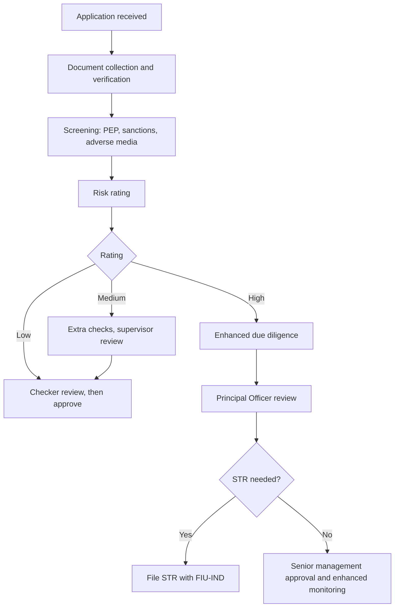

# Customer Due Diligence and Risk Escalation Framework

**A KYC/AML onboarding simulation (India)**

| | |
|---|---|
| **Author** | Meenu, BBA LLB |
| **Version** | 1.0 |
| **Status** | Educational simulation. No real customers or data. |
| **Applies to** | Onboarding of individual and corporate customers at an Indian bank or NBFC |

---

## 1. Why I built this

I am a law graduate moving into financial crime compliance. I wanted to show how I think through an onboarding case, not only list the rules I have read. This project follows the way a KYC team works: collect documents, verify them, rate the risk, decide, and write down the reasons.

It has one standard procedure and four worked cases: two low-risk, one medium-risk, and one with a hidden owner that ends in an escalation.

---

## 2. Scope and regulatory basis

**In scope:** customer onboarding, risk rating, enhanced due diligence (EDD), escalation, and a draft suspicious transaction report (STR).

**Out of scope:** transaction monitoring systems, sanctions screening tools, and ongoing periodic reviews.

**Framework used:**
- Prevention of Money Laundering Act, 2002 (PMLA) and the PML (Maintenance of Records) Rules
- RBI Master Direction on Know Your Customer
- FIU-IND guidance on STR filing
- FATF guidance on the risk-based approach

> Rules and thresholds change. Check the current version of each document before using this as a reference.

---

## 3. Roles and workflow

| Role | Responsibility |
|------|----------------|
| **Maker (KYC Analyst)** | Collects and verifies documents, screens the customer, proposes a risk rating and decision |
| **Checker (Senior Analyst)** | Reviews the maker's file independently and approves or sends it back |
| **Principal Officer / Compliance** | Decides on STR filing and handles High-risk escalations |
| **Senior Management** | Approves High-risk and PEP relationships |



---

## 4. Standard CDD procedure

| Step | Action | Evidence kept |
|------|--------|---------------|
| 1 | Verify identity using an officially valid document (OVD) and PAN or Form 60 | Document copies, verification log |
| 2 | Verify current address; flag any mismatch with the OVD | Address proof |
| 3 | Identify customer type: individual, company, partnership, trust | Application form |
| 4 | For entities, identify the beneficial owner (BO), meaning the natural person who owns or controls the entity | Ownership chart, declarations |
| 5 | Screen all parties for PEP status, sanctions, and adverse media | Screening report |
| 6 | Establish purpose of the account and expected activity | Customer profile |
| 7 | Establish source of funds and, where needed, source of wealth | Supporting documents |
| 8 | Assign a risk rating | Scoring sheet |
| 9 | Record the decision and the reasons | Decision memo |
| 10 | Keep all records for the required retention period | File |

---

## 5. Risk rating methodology

Each factor is scored 1 (low), 2 (medium) or 3 (high).

| Factor | 1 | 2 | 3 |
|--------|---|---|---|
| Customer type | Salaried individual | Small business | Complex entity, trust, shell-like structure |
| Ownership clarity | Clear | Partly layered | Multiple layers or offshore holding |
| Geography | India, low-risk links | Some cross-border links | High-risk or secrecy jurisdictions |
| PEP exposure | None | Distant link | Direct PEP or PEP as BO |
| Product / channel | Savings, face to face | Current account | Cash-heavy, non-face-to-face, trade |
| Expected vs. actual activity | Matches | Slight gap | Large unexplained gap |

| Total | Rating | Action |
|-------|--------|--------|
| 6 to 9 | Low | Standard CDD, approve after checker review |
| 10 to 13 | Medium | Additional checks and supervisor review |
| 14 to 18 | High | EDD and escalation to Principal Officer |

**Override rule:** a confirmed PEP, or an ownership structure that cannot be explained, is rated High whatever the total.

*This scale is my own simplified model for the exercise. Real institutions use risk policies approved by their board.*

---

## 6. Escalation matrix

| Situation | Escalate to | Timing |
|-----------|-------------|--------|
| Document looks altered or forged | Checker and Compliance | Same day |
| PEP or PEP-linked BO found | Senior management, via Compliance | Before account opening |
| Beneficial owner cannot be identified | Compliance | Do not proceed until resolved |
| Activity does not fit the profile | Principal Officer | As soon as noticed |
| Reasonable grounds for suspicion | Principal Officer, for STR decision | Promptly. Do not tip off the customer. |

---

## 7. Case files

### Case 001: Individual, salary account

| | |
|---|---|
| **Customer** | Anitha Joseph (fictional), 29, software tester, Kollam |
| **Product** | Salary savings account |
| **Expected activity** | Salary credit of about ₹45,000 a month, small UPI spends |
| **Documents** | Aadhaar, PAN, employer ID, salary slip |

**Verification log**
- Identity and PAN verified and consistent.
- The Aadhaar address is her parents' home in Alappuzha. She rents in Kollam. This is a minor mismatch, resolved with a rental agreement and a utility bill.
- No PEP, sanctions, or adverse media hits.

**Risk score: 6 (Low)**, all six factors scored 1.

**Decision memo**
> Approve under standard CDD. The only exception was the address mismatch, which is explained and documented. No further action. Next review at the standard periodic interval.

---

### Case 002: Company with an undisclosed owner

| | |
|---|---|
| **Customer** | Meridian Spice Exports Pvt Ltd (fictional), Kochi |
| **Product** | Current account |
| **Stated business** | Export of spices |
| **Declared shareholding** | Two Indian directors at 20% each; 60% held by Al Noor Trading FZE (fictional, foreign) |
| **Expected activity** | About ₹15 lakh a month |

**Step 1: Look through the ownership**

```
Meridian Spice Exports Pvt Ltd
 ├─ Director A: 20%
 ├─ Director B: 20%
 └─ Al Noor Trading FZE: 60%
       └─ Kestrel Holdings Ltd: 100%
             └─ Rajan Kurian (individual): 100%   <-- beneficial owner
```

Adverse media screening shows Rajan Kurian is a close relative of a sitting state minister (fictional). He is a PEP-linked BO. The customer did not disclose this.

**Step 2: Compare expected and actual activity (first 60 days)**

| Item | Expected | Actual |
|------|----------|--------|
| Monthly credits | ₹15 lakh | About ₹1.2 crore |
| Source of credits | Foreign buyers | Many small credits from unrelated individuals, mostly cash across several branches |
| Debits | Supplier payments | Quick transfers to the overseas parent |

**Red flags**
1. Layered foreign ownership, with no BO disclosed
2. PEP-linked BO not declared
3. Activity many times higher than the stated profile
4. Cash deposits spread over several branches (possible structuring)
5. Funds moved out quickly to the overseas parent (possible layering)
6. No visible link between the money and real spice exports

**Risk score: 17 (High)**

| Factor | Score |
|--------|-------|
| Customer type | 3 |
| Ownership clarity | 3 |
| Geography | 2 |
| PEP exposure | 3 |
| Product / channel | 3 |
| Expected vs. actual | 3 |

**Decision memo**
> Rated High. Do not continue the relationship on normal terms. Request EDD: BO declaration, source of wealth, export invoices, shipping documents, and buyer contracts. Escalate to the Principal Officer for an STR decision. Senior management approval is needed before any continuation. The customer must not be told that an STR is under consideration.

---

### Cases 003 and 004: short summaries

**Case 003: Kovai Textile Traders (fictional partnership firm). Score 10, Medium.**
Two partners are declared, but a third person signs cheques and has no partner status. The turnover estimate is not yet backed by GST returns. Decision: hold the account, request the partnership deed, GST returns and signatory authority, and send for supervisor review.

**Case 004: R. Kumar (fictional individual). Score 6, Low.**
A partial name match appeared on a sanctions list. Date of birth, father's name and ID number do not match, so it is a false positive. Decision: approve after documenting the comparison with screenshots.

The full scoring for all four cases is in the companion workbook, `KYC_Risk_Rating_Workbook.xlsx`. Its scores, ratings and escalation columns are formulas, and the summary sheet counts cases by rating.

---

## 8. Draft STR narrative (Case 002)

> **Subject:** Meridian Spice Exports Pvt Ltd, current account (fictional)
>
> **Grounds for suspicion:** The account was opened as an export business account with expected monthly credits of about ₹15 lakh. In the first 60 days, credits were about ₹2.4 crore, mostly from unrelated individuals, largely through cash deposits at multiple branches. Funds were then moved promptly to the overseas parent company.
>
> Ownership checks showed that 60% of the company is held through two foreign layers by an individual who is a close relative of a state minister. This was not disclosed at onboarding.
>
> The activity does not match the stated business or the customer profile, and the customer did not provide supporting export documents when asked. The pattern is consistent with structuring and layering.
>
> **Recommended action:** File an STR with FIU-IND, continue EDD, and refer the relationship for senior management review.

---

## 9. Checker review checklist

Before approval, the checker confirms:

- [ ] All mandatory documents are present, valid and legible
- [ ] Name, date of birth and address are consistent across documents
- [ ] All parties, including beneficial owners, were screened
- [ ] Ownership has been traced to a natural person
- [ ] Expected activity and source of funds are recorded
- [ ] The risk score adds up and matches the written reasons
- [ ] The decision follows the escalation matrix
- [ ] The decision memo is clear enough for a reviewer who has not seen the file

---

## 10. Quality measures (illustrative)

These are targets I would suggest for a team. They are assumptions for this exercise, not data from a real operation.

| Measure | Example target |
|---------|----------------|
| Turnaround for Low-risk individual cases | Same or next business day |
| Checker error rate on files reviewed | Below 5% |
| Files with complete BO identification | 100% |
| High-risk cases escalated within the required time | 100% |

---

## 11. Limitations

- Both cases are made up. Real files are messier and the evidence is rarely this clear.
- The risk model is simplified and is not a regulator's formula.
- I have not worked in an AML/KYC operation. This project shows my understanding of the process and how I reason through cases.
- Thresholds, forms and timelines must be checked against current regulations.

---

## 12. References

- Prevention of Money Laundering Act, 2002, and PML Rules
- RBI Master Direction: Know Your Customer
- FIU-IND: STR reporting guidance
- FATF: Guidance on the risk-based approach
